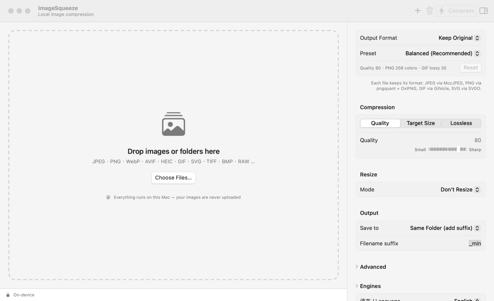
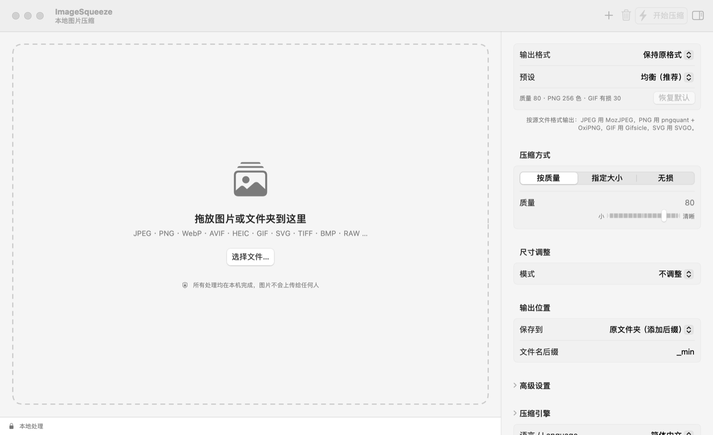

# ImageSqueeze

**A native macOS image compressor. Everything runs on your Mac — your images are never uploaded.**

[English](#english) · [简体中文](#简体中文)



## English

ImageSqueeze is a SwiftUI app that brings together the best open-source image optimizers — MozJPEG, pngquant, OxiPNG, pngcrush, libwebp, Gifsicle and SVGO — behind one drag-and-drop window. All engines are bundled inside the app, so there is nothing else to install.

### Features

- **Many formats** — reads JPEG, PNG, WebP, AVIF, HEIC, GIF (including animations), SVG, TIFF, BMP, PSD, RAW and more; writes JPEG, PNG, WebP, AVIF, HEIC, GIF, TIFF, or keeps each file's format
- **Three compression modes**
  - *Quality* — pick a quality level
  - *Target size* — e.g. "≤ 500 KB": binary-searches for the highest quality that fits, and shrinks the image only if it still doesn't
  - *Lossless* — jpegtran / OxiPNG / Gifsicle re-optimization with no quality loss
- **Resize** — by percentage, fit within W×H, set width or height, or exact size (crop to fill or stretch)
- **Batch processing** — drop files or whole folders (scanned recursively); images are processed in parallel, and subfolder structure is kept when saving to another folder
- **Presets** — Balanced, Smallest, High Quality, Lossless; switches to *Custom* as soon as you tweak anything
- **Advanced output settings** — keep or strip EXIF/GPS, progressive JPEG, chroma subsampling, PNG color count, OxiPNG level or pngcrush, WebP method, GIF lossiness, SVG precision, background color for transparency, keep the original when the result is larger
- **Output location** — next to the original with a suffix, a chosen folder, or overwrite (originals go to the Trash)
- **Smart details** — EXIF orientation is applied, so phone photos come out upright
- **Chinese / English interface**, switchable instantly
- **Private by design** — no network access, no analytics; all processing is local

### Install

Download `ImageSqueeze.zip` from [Releases](../../releases), unzip it, and move `ImageSqueeze.app` to Applications. Requires macOS 14 Sonoma or later on Apple silicon.

The app is ad-hoc signed, not notarized. The first time you open it, macOS will block it: right-click the app → **Open**, or allow it under System Settings → Privacy & Security → **Open Anyway**.

### Engines

| Format | Engine |
|---|---|
| JPEG | [MozJPEG](https://github.com/mozilla/mozjpeg) (`cjpeg`, `jpegtran`) |
| PNG | [pngquant](https://github.com/kornelski/pngquant) + [OxiPNG](https://github.com/oxipng/oxipng), optionally [pngcrush](https://pmt.sourceforge.io/pngcrush/) |
| WebP | [libwebp](https://chromium.googlesource.com/webm/libwebp) (`cwebp`) |
| GIF | [Gifsicle](https://github.com/kohler/gifsicle) |
| SVG | [SVGO](https://github.com/svg/svgo), run in macOS's JavaScriptCore (no Node.js needed) |
| AVIF / HEIC / TIFF | macOS ImageIO |

### Build from source

Requires Xcode 15.3+ (Swift 5.10), [Homebrew](https://brew.sh) and Node.js.

```bash
brew install oxipng pngquant mozjpeg webp gifsicle pngcrush dylibbundler
./scripts/build_app.sh
```

The script compiles the app, bundles the engines and rewrites their library paths so they load from inside the app, builds the SVGO bundle, draws the icon, and ad-hoc signs the result to `dist/ImageSqueeze.app`.

**Command-line mode** uses the same engine as the app. Pass settings as JSON; any keys you omit keep their defaults:

```bash
dist/ImageSqueeze.app/Contents/MacOS/ImageSqueeze --cli '{"format":"webp","quality":75}' photo.jpg icon.png
```

### Project layout

```
Sources/ImageSqueeze/
  Engine.swift          decode → resize → encode pipeline, target-size search
  Tools.swift           locating and running the bundled command-line engines
  SVGOptimizer.swift    SVGO in JavaScriptCore
  Settings.swift        settings, presets, persistence
  AppModel.swift        file list and batch processing
  ContentView.swift     main window
  SettingsPanel.swift   settings inspector
  Localization.swift    Chinese / English strings via L("中文", "English")
scripts/                build_app.sh, icon drawing
vendor/svgo/            SVGO bundle source
```

### License

ImageSqueeze is released under the [MIT License](LICENSE). The bundled engines keep their own licenses — see [THIRD_PARTY_NOTICES.md](THIRD_PARTY_NOTICES.md).

---

## 简体中文

ImageSqueeze 是一款原生 macOS 图片压缩工具，把 MozJPEG、pngquant、OxiPNG、pngcrush、libwebp、Gifsicle、SVGO 这些优秀的开源压缩引擎整合到一个拖放窗口里。引擎全部内置在 app 中，无需另外安装任何东西。**所有处理均在本机完成，图片不会被上传给任何人。**



### 功能

- **多种格式**：读取 JPEG、PNG、WebP、AVIF、HEIC、GIF（含动图）、SVG、TIFF、BMP、PSD、RAW 等；输出 JPEG、PNG、WebP、AVIF、HEIC、GIF、TIFF，或保持原格式
- **三种压缩方式**
  - 按质量：自选质量
  - 指定大小：例如“≤ 500 KB”，自动搜索不超过目标的最高质量，仍然过大时才缩小尺寸
  - 无损：jpegtran / OxiPNG / Gifsicle 重新优化，不损失画质
- **尺寸调整**：按百分比、限制最大宽高、指定宽度或高度、精确尺寸（居中裁剪或拉伸）
- **批量处理**：拖入文件或整个文件夹（递归扫描），多张并行处理；输出到其他文件夹时保留子目录结构
- **预设**：均衡、极致压缩、高画质、无损优化；手动调整任何参数后自动变为“自定义”
- **高级输出设置**：保留或移除 EXIF/GPS、渐进式 JPEG、色度抽样、PNG 颜色数、OxiPNG 级别或改用 pngcrush、WebP 压缩方法、GIF 有损程度、SVG 精度、透明区域背景色、结果更大时保留原图
- **输出位置**：原文件夹加后缀、指定文件夹，或覆盖原文件（原文件移到废纸篓）
- 自动应用 EXIF 方向，手机拍的竖图不会转歪
- **中英文界面**，即时切换
- **隐私保护**：不联网、不统计，全部本地处理

### 安装

从 [Releases](../../releases) 下载 `ImageSqueeze.zip`，解压后把 `ImageSqueeze.app` 拖到“应用程序”文件夹。需要 macOS 14 Sonoma 或更新版本、Apple 芯片的 Mac。

本应用为 ad-hoc 签名，未经公证。第一次打开时 macOS 会拦截：右键点击 app → **打开**，或在“系统设置 → 隐私与安全性”中点击**仍要打开**。

### 从源码构建

需要 Xcode 15.3+（Swift 5.10）、[Homebrew](https://brew.sh) 和 Node.js。

```bash
brew install oxipng pngquant mozjpeg webp gifsicle pngcrush dylibbundler
./scripts/build_app.sh
```

脚本会编译应用，把压缩引擎打包进 app 并改写依赖库路径，构建 SVGO，生成图标，并做 ad-hoc 签名，输出到 `dist/ImageSqueeze.app`。

**命令行模式**与界面使用同一套引擎，设置用 JSON 传入，省略的键使用默认值：

```bash
dist/ImageSqueeze.app/Contents/MacOS/ImageSqueeze --cli '{"format":"webp","quality":75}' photo.jpg icon.png
```

### 许可证

ImageSqueeze 以 [MIT 许可证](LICENSE) 开源。内置的压缩引擎各自遵循其原有许可证，详见 [THIRD_PARTY_NOTICES.md](THIRD_PARTY_NOTICES.md)。
